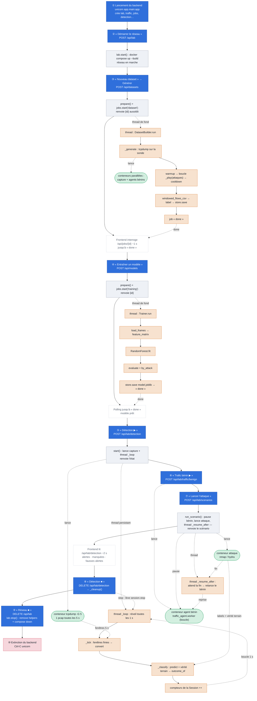
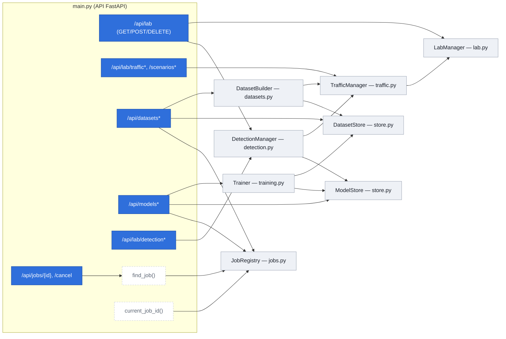
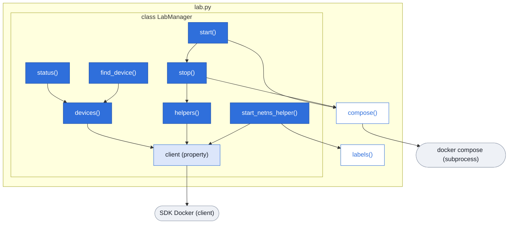
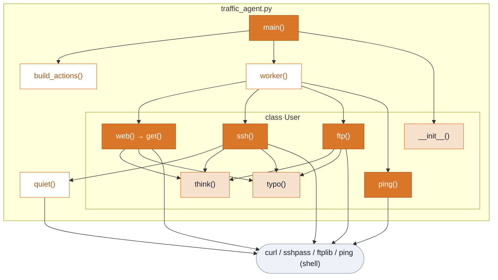
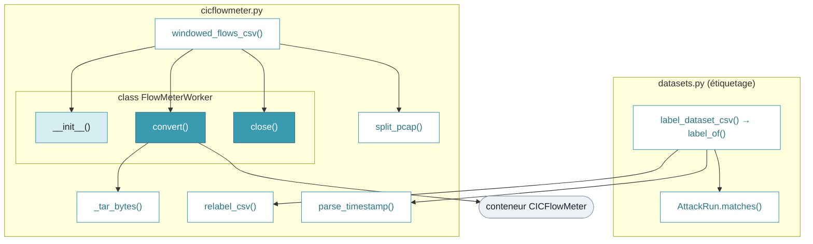
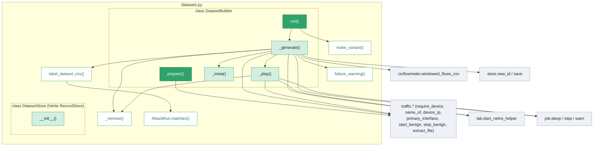
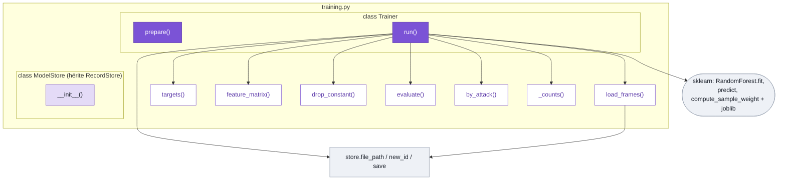
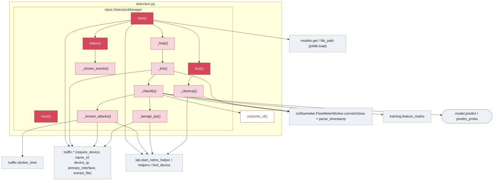
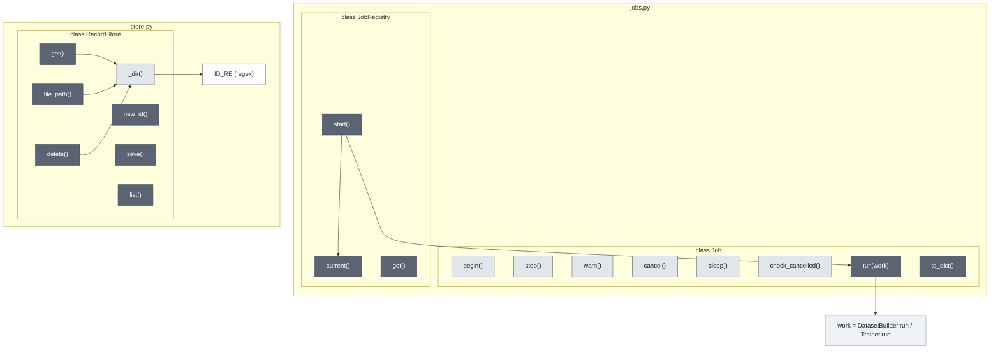

# Carte des appels du backend

Toutes les fonctions définies dans `backend/app/` (le front est écarté : généré par IA).
Un diagramme par module/sous-système.

**Convention de lecture :**

- **Flèche `A --> B`** : `A` appelle `B` (ou les deux se suivent dans l'ordre d'exécution).
- **Boîte englobante (`subgraph`)** : un module ou une classe. Les fonctions dedans sont ses
  méthodes/fonctions ; un appel qui reste dans la boîte est un **appel interne**, un appel qui
  en sort pointe vers une autre boîte (souvent un autre module).
- **Couleurs** (classes en bas de chaque diagramme) :
  - `entry` = route de l'API (`main.py`)
  - `pub` = méthode publique / orchestrateur
  - `aux` = helper interne (nom en `_`)
  - `pure` = fonction de module sans état (testable isolément)
  - `ext` = cible hors du module courant (autre manager, Docker, lib externe)

> Les blocs ` ```mermaid ` se rendent directement sur GitHub et dans la plupart des éditeurs
> Markdown. Fais ton tri en éditant le texte.

---

## Flux d'exécution global — du démarrage à l'extinction

Le déroulé chronologique d'une démo complète. **Une seule colonne** tant que c'est séquentiel
(un bloc, une flèche vers le suivant). **Dès qu'un thread ou un conteneur tourne en parallèle**,
une flèche part sur le côté (flèche en pointillé) pendant que la colonne principale continue tout
droit ; elle rejoint la colonne plus bas au point de synchronisation (`done`, reprise…).

- Bleu = action de l'utilisateur · Gris = réponse du backend (fil principal) · Pointillé clair = attente/polling
- Orange = étape d'un **thread** de fond · Vert = **conteneur** Docker en parallèle · Rouge = extinction



---

# Détail des appels par module

Les diagrammes suivants détaillent, module par module, qui appelle qui à l'intérieur de chaque
étape du flux global ci-dessus.

## 0. Vue d'ensemble — `main.py` crée les objets et route les requêtes



---

## 1. `lab.py` — pont Docker (topologie + conteneurs auxiliaires)



---

## 2. `traffic.py` — trafic bénin, attaques, vérité terrain

```mermaid
flowchart TD
  subgraph TRAF["traffic.py"]
    nmap["_nmap_cmd()"]:::pure
    hydra["_hydra_cmd() → build()"]:::pure
    stealth["_ftp_stealth_cmd()"]:::pure
    think["think()"]:::pure
    pad["pad()"]:::pure
    attempt["attempt()"]:::pure
    preview["command_preview()"]:::pure
    atkCat["attack_catalog()"]:::pure
    spdCat["speed_catalog()"]:::pure
    atkRes["attack_result()"]:::pure
    dTime["docker_time()"]:::pure
    ATTACKS[["ATTACKS / SPEEDS (catalogues)"]]:::pure

    subgraph TM["class TrafficManager"]
      reqDev["require_device()"]:::pub
      nameOf["name_of()"]:::pub
      devIp["device_ip()"]:::pub
      primIf["primary_interface()"]:::pub
      extract["extract_file()"]:::pub
      startBen["start_benign()"]:::pub
      stopBen["stop_benign()"]:::pub
      runScen["run_scenario()"]:::pub
      listScen["list_scenarios()"]:::pub
      stopScen["stop_scenarios()"]:::pub
      clrScen["clear_scenarios()"]:::pub
      overview["overview()"]:::pub
      pause["_pause_benign()"]:::aux
      resume["_resume_benign()"]:::aux
      resAfter["_resume_after()"]:::aux
      waitFin["_wait_until_finished()"]:::aux
      scenInfo["_scenario_info()"]:::aux
    end
  end

  labEXT["lab.start_netns_helper / helpers / find_device"]:::ext
  agentEXT["traffic_agent.py (dans le conteneur)"]:::ext

  nmap --> ATTACKS
  hydra --> ATTACKS
  stealth --> ATTACKS
  stealth --> think & pad & attempt

  findDev2["lab.find_device"]:::ext
  reqDev --> findDev2
  startBen --> reqDev & stopBen & nameOf
  startBen --> labEXT
  startBen --> agentEXT
  stopBen --> labEXT
  runScen --> reqDev & pause & scenInfo & nameOf
  runScen --> labEXT
  runScen --> resAfter
  listScen --> scenInfo
  listScen --> labEXT
  stopScen --> labEXT
  clrScen --> labEXT
  overview --> listScen & labEXT
  pause --> stopBen & labEXT
  resume --> labEXT
  resAfter --> waitFin & resume
  scenInfo --> dTime & atkRes & preview

  classDef pub fill:#d9772a,stroke:#a95712,color:#fff;
  classDef aux fill:#f7e2cf,stroke:#d9772a,color:#1a1f29;
  classDef pure fill:#fff,stroke:#d9772a,color:#a95712;
  classDef ext fill:#eef1f6,stroke:#9aa3b2,color:#1a1f29;
```



---

## 3. `traffic_agent.py` — le « faux utilisateur » (exécuté DANS le conteneur toolbox)



---

## 4. `cicflowmeter.py` + l'étiquetage de `datasets.py` — pcap → flux étiquetés



---

## 5. `datasets.py` — génération d'un dataset (tâche de fond)



---

## 6. `training.py` — entraînement du Random Forest (tâche de fond)



---

## 7. `detection.py` — détection en direct (session + boucle)



---

## 8. `jobs.py` + `store.py` — briques transverses



---

### Note

`store.py` expose `RecordStore` ; `DatasetStore` (`datasets.py`) et `ModelStore` (`training.py`)
en héritent — donc `datasets.save/new_id/...` et `models.save/file_path/...` sont en fait les
méthodes de `RecordStore` ci-dessus. Les classes de données (`BenignSource`, `AttackRun`,
`DatasetPlan`, `TrainingPlan`, `Session`) et les modèles Pydantic de `main.py`
(`StartRequest`, `Target`, `BenignRequest`, …) ne sont pas des fonctions : elles ne portent que
des champs (sauf `AttackRun.matches` et `Job.to_dict`, inclus ci-dessus).

Ordre de lecture conseillé du code : `settings → store → jobs → lab → traffic → cicflowmeter → datasets → training → detection → main`.
