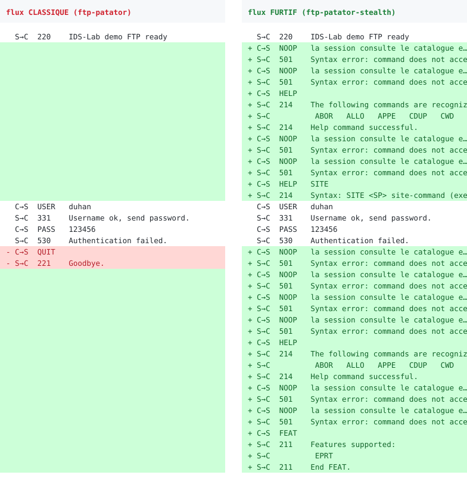

# Diff pcap d'un flux : force brute FTP classique vs furtive

Deux captures réseau réelles d'**un seul flux** chacune, pour le même essai de mot de passe
(`duhan` / `123456`, rejeté par le serveur). Même cœur d'attaque, deux formes de flux opposées.
Ouvre-les dans Wireshark :

- [`flux_classique.pcap`](flux_classique.pcap) — un login raté « nu » (ce qu'émet `ftp-patator` / hydra).
- [`flux_furtif.pcap`](flux_furtif.pcap) — le même essai, « habillé » par le script d'évasion.

> Ce ne sont pas des schémas : ce sont de **vrais paquets** capturés au niveau TCP. Les traces
> ci-dessous sont la sortie de `tshark`, le diff est un `diff` de ces deux traces.

---

## Mesuré sur les deux flux

| Grandeur (par flux)                | 🔴 Classique | 🟢 Furtif | Rapport |
| ---------------------------------- | -----------: | --------: | ------: |
| Trames TCP                         |         17   |      70   |  ×4,1   |
| Octets applicatifs (payload)       |      134 o   |  4 328 o  |  **×32**|
| Octets totaux (avec en-têtes)      |    1 272 o   |  8 964 o  |  ×7,0   |
| Taille moyenne de trame            |     74,8 o   |  128,1 o  |  ×1,7   |

Le modèle décide **par flux**, surtout sur des **tailles de paquet** et le **volume d'octets**
(`Packet Length Mean`, `Average Packet Size`, `Flow Bytes/s`). Le flux classique est un flux
**pauvre** (134 o) → zone « attaque ». Le flux furtif échange **32× plus d'octets applicatifs** →
il tombe dans la zone « session normale ». L'attaque n'a ni changé d'outil ni ralenti : elle a
changé la **forme** du flux.

---

## Le diff (niveau commande FTP)

Les deux traces `tshark` côte à côte (`C→S` = client vers serveur, `S→C` = serveur vers client).
Le cœur de l'attaque — `USER duhan` → `331` → `PASS 123456` → `530` — est **identique** (lignes
blanches, alignées). En **vert** le **bourrage** ajouté par l'attaque furtive (`NOOP` à grosse
ligne d'arguments, `HELP` / `FEAT` à longue réponse) ; en **rouge** ce qu'elle retire (le
`QUIT`/`221` propre du classique).



<details><summary>Même diff en version texte unifiée (copiable)</summary>

```diff
  S→C  220    IDS-Lab demo FTP ready
+ C→S  NOOP   la session consulte le catalogue e…(260o)
+ S→C  501    Syntax error: command does not accept ar…
+ C→S  NOOP   la session consulte le catalogue e…(172o)
+ S→C  501    Syntax error: command does not accept ar…
+ C→S  HELP
+ S→C  214    The following commands are recognized:
+ S→C          ABOR   ALLO   APPE   CDUP   CWD    DELE…
+ S→C  214    Help command successful.
+ C→S  NOOP   la session consulte le catalogue e…(167o)
+ S→C  501    Syntax error: command does not accept ar…
+ C→S  HELP   SITE
+ S→C  214    Syntax: SITE <SP> site-command (execute …
  C→S  USER   duhan
  S→C  331    Username ok, send password.
  C→S  PASS   123456
  S→C  530    Authentication failed.
- C→S  QUIT
- S→C  221    Goodbye.
+ C→S  NOOP   la session consulte le catalogue e…(123o)
+ S→C  501    Syntax error: command does not accept ar…
+ C→S  NOOP   la session consulte le catalogue e…(336o)
+ S→C  501    Syntax error: command does not accept ar…
+ C→S  NOOP   la session consulte le catalogue e…(292o)
+ S→C  501    Syntax error: command does not accept ar…
+ C→S  NOOP   la session consulte le catalogue e…(303o)
+ S→C  501    Syntax error: command does not accept ar…
+ C→S  HELP
+ S→C  214    The following commands are recognized:
+ S→C          ABOR   ALLO   APPE   CDUP   CWD    DELE…
+ S→C  214    Help command successful.
+ C→S  NOOP   la session consulte le catalogue e…(313o)
+ S→C  501    Syntax error: command does not accept ar…
+ C→S  NOOP   la session consulte le catalogue e…(441o)
+ S→C  501    Syntax error: command does not accept ar…
+ C→S  FEAT
+ S→C  211    Features supported:
+ S→C          EPRT
+ S→C  211    End FEAT.
```

</details>

Diff brut et traces : [`unified.diff`](unified.diff),
[`trace_classique.txt`](trace_classique.txt), [`trace_furtif.txt`](trace_furtif.txt).

> **Lecture.** Les lignes non colorées sont l'attaque réelle, bit pour bit la même. Le furtif ne
> « cache » pas l'essai de mot de passe : il le **noie** dans assez de vrai trafic FTP (le vert)
> pour que la fiche de statistiques du flux ressemble à celle d'une session bénigne.

---

## Reproduire

Capture locale, 100 % reproductible, sans la pile Docker du lab (voir [`repro/`](repro/)) :

1. serveur FTP local (`pyftpdlib`) sur `127.0.0.1:2121` ;
2. capture de `lo` (port 2121) ;
3. `classic.py` (un login raté nu) puis `stealth.py` (le vrai script `_FTP_STEALTH` du projet,
   [`code/backend/app/traffic.py`](../../code/backend/app/traffic.py), adapté au port local).

```bash
python3 -m venv venv && ./venv/bin/pip install pyftpdlib
bash repro/run.sh      # produit capture.pcap ; filtrer par tcp.stream pour isoler chaque flux
```

> **Fidélité.** Le mécanisme (gros `NOOP` + réponses longues qui gonflent le flux) est exactement
> celui du script de production. Le serveur `pyftpdlib` refuse les arguments de `NOOP` (réponse
> `501` courte) là où un vrai serveur FTP renverrait plus d'octets : l'écart de volume mesuré ici
> (×32 sur le payload) est donc un **minorant** de celui obtenu dans le lab complet, où le rapport
> d'évasion mesure la détection chuter de ~87 % à ~9 % (`code/docs/rapports/rapport_evasion.md`).
